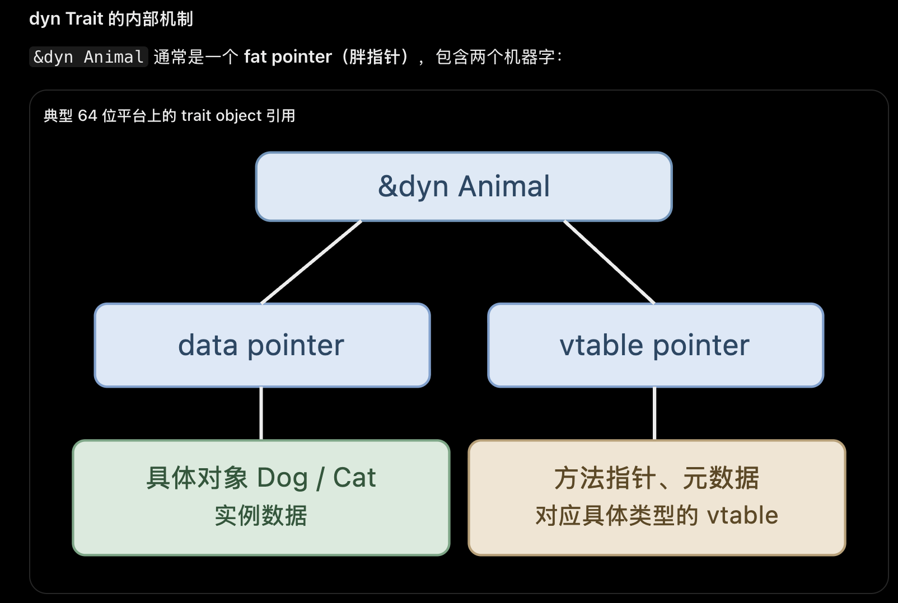

# Trait

`trait` 定义一组行为契约，类似于 C++ 的抽象接口。

例如，定义一个可以发出声音的 trait：

```rust
trait Animal {
    fn speak(&self);
}
```

这里没有定义任何具体动物，只规定：

任何实现 Animal 的类型，都必须提供 speak() 方法。

```rust
struct Dog;
struct Cat;

impl Animal for Dog {
    fn speak(&self) {
        println!("Woof!");
    }
}

impl Animal for Cat {
    fn speak(&self) {
        println!("Meow!");
    }
}
```

- impl Animal for Dog：为 Dog 实现 Animal trait。

- impl Animal for Cat：为 Cat 实现同一个 trait。

```rust
let dog = Dog;
let cat = Cat;

dog.speak();
cat.speak();
```

----

Difference between `trait` and normal `impl`

```rust
struct Dog;

impl Dog {
    fn run(&self) {
        println!("Running");
    }
}
// Question: what does &self mean? Does &self pointing to sturct Dog? or instance
//  dog?
```


`imple Dog` 为 Dog 定义固有方法.

`impl Animal for Dog` 为 Dog 实现 trait, 支持泛型和动态分发.

静态分发：impl Trait / 泛型

```rust
fn make_sound(animal: &impl Animal) {
    animal.speak();
}
```

```rust
fn make_sound<T: Animal>(animal: &T) {
    animal.speak();
}
```

```rust
make_sound(&Dog);
make_sound(&Cat);
```

编译器知道每次调用的具体类型，可以分别生成针对 Dog 和 Cat 的代码，这通常叫做 monomorphization（单态化）。不需要运行时虚函数查找

动态分发：dyn Trait

```rust
fn make_sound(animal: &dyn Animal) {
    animal.speak();
}
```

dyn Animal 表示一个实现了 Animal 的具体类型，但调用者不需要知道它究竟是 Dog 还是 Cat。

```rust
let dog = Dog;
let cat = Cat;

make_sound(&dog);
make_sound(&cat);
```


